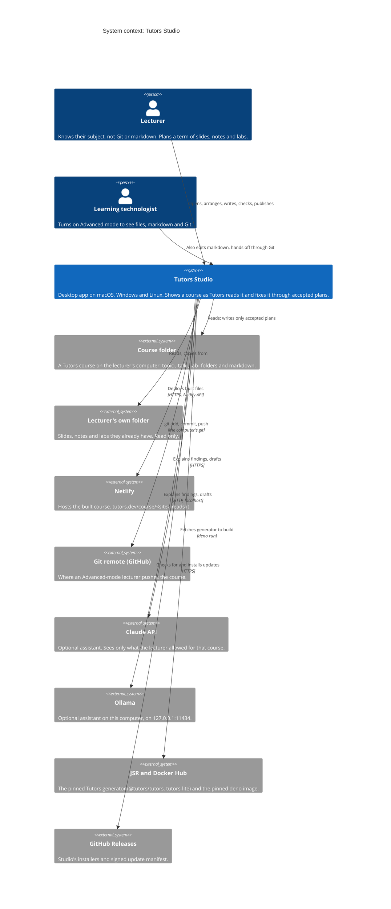
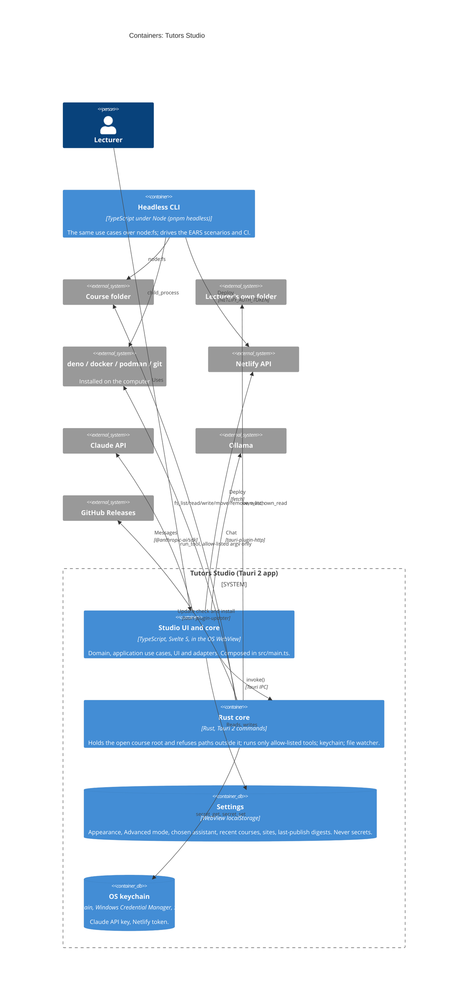
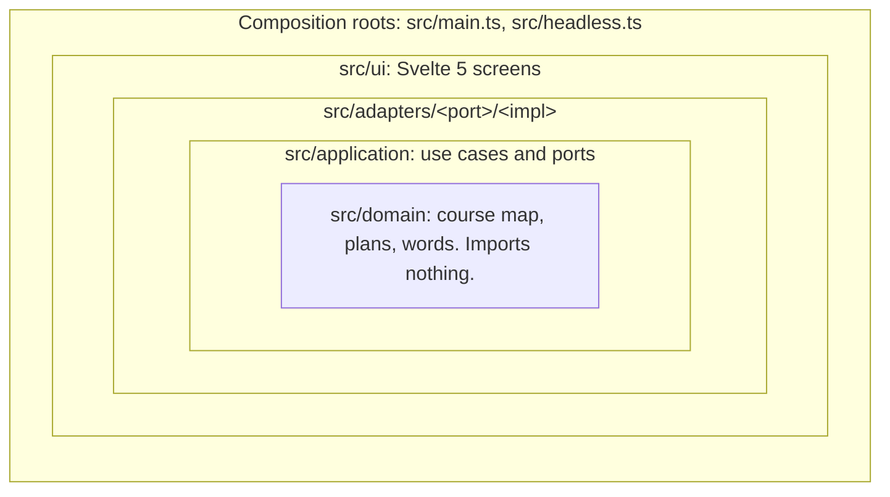
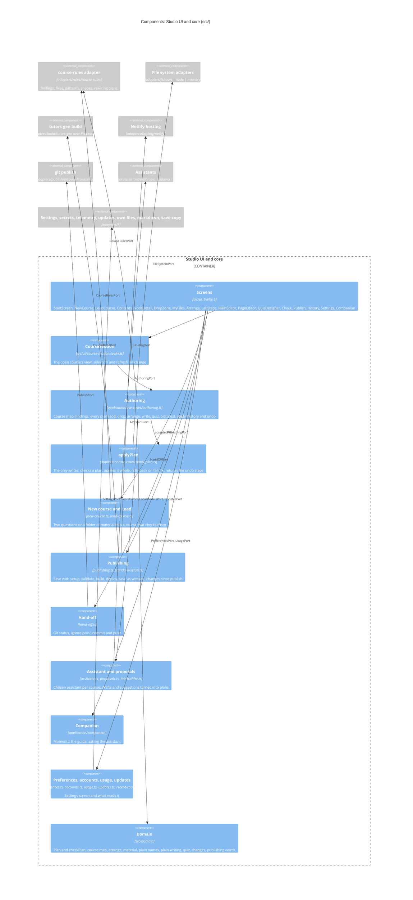
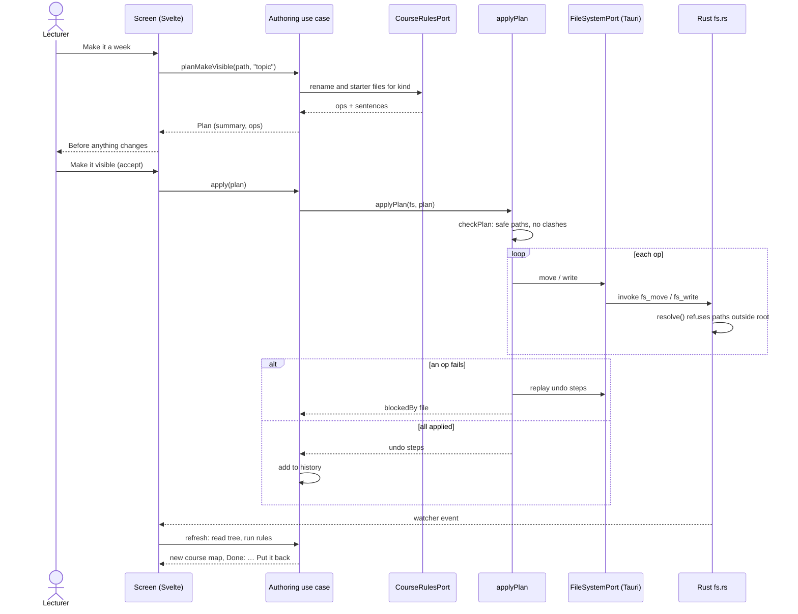
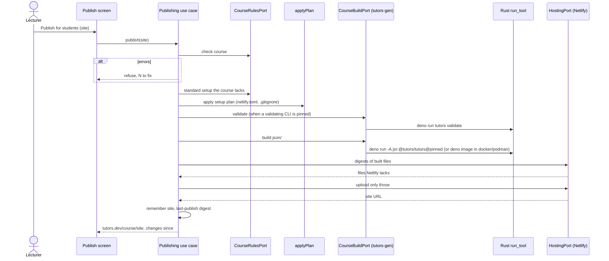

# Tutors Studio architecture

This document describes how Studio is built: what it talks to, what it's made of, and the rules that hold it together. It is written for maintainers and contributors. Lecturers want the [guides](guides/README.md).

The decisions behind it are in [docs/adr](adr/README.md). Where this document and an ADR disagree, the newer ADR wins and this document is out of date, so fix it. Behaviour is specified as EARS sentences with `STU-` ids in [spec/ears](../spec/ears/README.md). The rules every change follows are in [CLAUDE.md](../CLAUDE.md).

## What Studio is for

Studio shows a lecturer their Tutors course folder the way Tutors will read it, explains what's wrong in the lecturer's words, and fixes it through plans the lecturer accepts. Four commitments shape the architecture:

1. **The rules are Tutors' own.** Every finding comes from `@tutors/course-rules`, the package behind `tutors validate`, so Studio and the command line can never disagree (ADR [0003](adr/0003-course-rules-from-jsr-pinned.md), [0034](adr/0034-tutors-cli-is-the-gate.md)).
2. **Plan, then apply.** Nothing writes to a course except `applyPlan`, with a plan the lecturer accepted ([ADR 0004](adr/0004-plan-then-apply.md)). The one amendment is that files dropped on a week go straight in, with undo ([ADR 0038](adr/0038-drops-on-a-week-go-straight-in.md)).
3. **The course folder is the boundary.** The WebView can't touch a file outside the open course. The Rust side enforces this, not the TypeScript.
4. **Optional help, never required.** Studio works fully with no assistant, no network and no developer tools. Each of those adds something but takes nothing away.

## C4 level 1: system context

Students never meet Studio. They read the published course in the Tutors reader at tutors.dev, which reads what the Tutors generator built from the course folder. Studio's job ends when the course folder is correct and, optionally, online.

## C4 level 2: containers

Studio is one Tauri 2 application ([ADR 0001](adr/0001-tauri-2-as-the-desktop-shell.md)) with two halves: a Svelte 5 WebView that holds all the logic, and a small Rust core that holds every privilege. The headless CLI runs the same TypeScript under Node.

| Container          | Code                                           | Responsibility                                                                                                                                                                                                                                                                                                                                                                                                                                                                                                                                                                    |
| ------------------ | ---------------------------------------------- | --------------------------------------------------------------------------------------------------------------------------------------------------------------------------------------------------------------------------------------------------------------------------------------------------------------------------------------------------------------------------------------------------------------------------------------------------------------------------------------------------------------------------------------------------------------------------------- |
| Studio UI and core | `src/`                                         | Everything a lecturer sees, every rule about plans, every use case. Runs in the OS WebView (WebKit on macOS and Linux, WebView2 on Windows).                                                                                                                                                                                                                                                                                                                                                                                                                                      |
| Rust core          | `src-tauri/src`                                | `fs.rs`: opens one course root, resolves every course-relative path against it and refuses `..`, absolute paths, drive letters and backslashes (STU-0006); watches the folder and emits a change event (STU-0130). `own.rs`: the same for the lecturer's own folder, read only (ADR 0035). `tool.rs`: `run_tool` runs only `deno`, `git`, `docker` and `podman`, each only with the exact argument shapes Studio's adapters use, containers only with the pinned deno image and only mounting the open course; and `secret_get`/`secret_set` over the `keyring` crate (ADR 0016). |
| Settings           | `src/adapters/settings/local-storage`          | Typed per-user settings. Secrets are never stored here.                                                                                                                                                                                                                                                                                                                                                                                                                                                                                                                           |
| OS keychain        | `src-tauri/src/tool.rs`                        | The Claude key and the Netlify sign-in.                                                                                                                                                                                                                                                                                                                                                                                                                                                                                                                                           |
| Headless CLI       | `src/headless.ts`, `src/adapters/cli/headless` | The second composition root: the same use cases over `node:fs`, `child_process` and environment secrets. See [guide 11](guides/11-command-line.md).                                                                                                                                                                                                                                                                                                                                                                                                                               |
| Browser preview    | `pnpm dev`                                     | `src/main.ts` outside Tauri: a sample course in memory, no publishing, no keychain. For UI work and screenshots.                                                                                                                                                                                                                                                                                                                                                                                                                                                                  |

## The rings

Inside the WebView the code is hexagonal ([ADR 0002](adr/0002-hexagonal-rings.md)). `pnpm architecture` (dependency-cruiser, `.dependency-cruiser.cjs`) fails the build when a ring rule breaks.

| Rule (`.dependency-cruiser.cjs`)              | Meaning                                                                                                   |
| --------------------------------------------- | --------------------------------------------------------------------------------------------------------- |
| `domain-imports-nothing`                      | `src/domain` is pure TypeScript: no Svelte, no Tauri, no Node, no other ring.                             |
| `application-imports-only-domain`             | Use cases and ports know the domain and nothing else.                                                     |
| `adapters-never-import-ui-or-each-other`      | An adapter implements one port with one SDK.                                                              |
| `ui-never-imports-adapters`                   | Screens receive use cases as props; they never reach an adapter.                                          |
| `only-the-rules-adapter-imports-course-rules` | `@tutors/course-rules` (vendored in `vendor/course-rules` until it's on JSR) is behind `CourseRulesPort`. |
| `only-tauri-adapters-import-tauri`            | `@tauri-apps/*` appears only in `src/adapters/*/tauri`.                                                   |
| `no-circular`                                 | No import cycles.                                                                                         |

Only `src/main.ts` and `src/headless.ts` name adapters.

## C4 level 3: components of the Studio core

### Ports and adapters

Driving ports are what the UI and the CLI call. Driven ports are what the use cases call out through.

| Port              | Kind    | Adapters                                                                      | ADR                    |
| ----------------- | ------- | ----------------------------------------------------------------------------- | ---------------------- |
| `AuthoringPort`   | driving | `createAuthoring`                                                             | 0004                   |
| `PublishingPort`  | driving | `createPublishing`                                                            | 0019, 0030             |
| `HandOffPort`     | driving | `createHandOff`                                                               | 0021                   |
| `PreferencesPort` | driving | `createPreferences`                                                           | 0020, 0024             |
| `UsagePort`       | driving | `createUsage`                                                                 | 0037                   |
| `ToolHostPort`    | driving | none yet (MCP server, planned)                                                | 0007                   |
| `FileSystemPort`  | driven  | `fs/tauri`, `fs/node`, `fs/memory`; one contract suite runs against all three | 0009                   |
| `CourseRulesPort` | driven  | `rules/course-rules` over `vendor/course-rules` (pinned)                      | 0003                   |
| `AssistantPort`   | driven  | `assistant/anthropic`, `assistant/ollama`, `assistant/none`                   | 0005, 0022, 0028, 0036 |
| `LocalModelsPort` | driven  | `assistant/ollama` (`ollamaModels`)                                           | 0028                   |
| `CourseBuildPort` | driven  | `build/tutors-gen` (deno, or deno in docker/podman)                           | 0019, 0029, 0034       |
| `ProcessPort`     | driven  | `process/tauri` (`run_tool`), `process/node`                                  | 0019                   |
| `HostingPort`     | driven  | `hosting/netlify`                                                             | 0019                   |
| `PublishPort`     | driven  | `publish/git` over `ProcessPort`                                              | 0021                   |
| `SaveCopyPort`    | driven  | `save-copy/tauri`, `save-copy/node`                                           | 0029                   |
| `OwnFilesPort`    | driven  | `own-files/tauri`, `own-files/memory`                                         | 0035                   |
| `SettingsPort`    | driven  | `settings/local-storage`, `settings/memory`                                   | 0020                   |
| `SecretsPort`     | driven  | `secrets/tauri` (keychain), `secrets/env`, `secrets/memory`                   | 0016                   |
| `MarkdownPort`    | driven  | `markdown/markdown-it` (raw HTML shown as text)                               | 0025                   |
| `TelemetryPort`   | driven  | `telemetry/local`, wrapped by the opt-in counter                              | 0037                   |
| `UpdatesPort`     | driven  | `updates/tauri`, `updates/none`                                               | 0033                   |

A new port, a new adapter for a port, an MCP schema change, a token change or an unpinned dependency needs an ADR.

## How a change reaches the disk

Every write goes through one function. A `Plan` is a list of `write` and `move` operations on course-relative paths with a one-line summary (`src/domain/plan.ts`). `checkPlan` rejects the whole plan if any path is unsafe, two operations land on one path, or a move goes nowhere. `applyPlan` (`src/application/use-cases/apply-plan.ts`) applies the operations in order, records an undo step for each, and on any failure replays the undo steps and reports the file that blocked it (STU-0004). The Rust side checks every path again.

Undo is the same path in reverse. History keeps each applied plan's undo steps. **Put back** turns them into a new plan, shown and accepted like any other. Files the plan added are moved to `.tutors-bin/`, never deleted, and a file changed since is left alone and named (STU-0091 to STU-0094, [ADR 0032](adr/0032-undo-history-and-the-bin.md)).

## How a course is published

**Save the course** stops after the setup plan and the validation, with no build and nothing sent ([ADR 0030](adr/0030-publish-saves-a-compliant-course.md)). **Save as a website** builds with tutors-lite into `html/` and copies it to a new folder the lecturer picks, never over an existing one ([ADR 0029](adr/0029-save-the-course-as-a-website.md)). The Git hand-off runs `git status`, `add -A`, `commit -m` and `push -u <remote> HEAD`, nothing else, and refuses while the course has errors or its `.gitignore` would commit `json/` ([ADR 0021](adr/0021-handing-off-through-the-computers-git.md)).

## Files in a course

Studio places every file where Tutors will publish and link it: a PDF that is content gets its own Talk or Tutorial folder; a file that supports a lab or note goes in that page's `archives/` folder and is linked as `archives/name`; a download is an Archive holding one zip; module-wide files go in the `side/` unit; never a kindless folder at the course root. The standard, and the reasons read from the generator and reader code, are in [Course files](course-files.md). It is decided in [ADR 0040](adr/0040-files-belong-to-what-shows-them.md) and specified by STU-0155 to STU-0161. The placement code is the material planning in `authoring.ts` over course-rules' `shape` and tutors-create's item layout: Word and other unpublished types are zipped into a note's `archives/`, files beside a lab's steps go to its `archives/` with the links rewritten, extensions are lower-cased, and **Attach a file** writes the file and the page in one plan. A file of a kind Tutors doesn't show, dropped as itself, is kept unopened in the week's `files/` working folder, which course-rules accepts (V018).

## Privacy and trust boundaries

| Boundary                             | What crosses it                                                                                                                       | Guard                                                                                                                            |
| ------------------------------------ | ------------------------------------------------------------------------------------------------------------------------------------- | -------------------------------------------------------------------------------------------------------------------------------- |
| WebView to disk                      | Course-relative paths only                                                                                                            | `fs.rs` `resolve()`; `checkPlan`                                                                                                 |
| WebView to the lecturer's own folder | Reads only                                                                                                                            | `own.rs` has no write command (ADR 0035)                                                                                         |
| WebView to programs                  | `deno`, `git`, `docker`, `podman` with fixed argument shapes                                                                          | `tool.rs` `allowed()`; containers: one pinned image, no `--privileged`/`--network`/`--env`/extra mounts, only the course mounted |
| Studio to Claude                     | The finding, the question, the screen name and checker sentences; for drafts, only the lab notes or the week's titles and page starts | Per-course read permission (ADR 0006); nothing sent until allowed (STU-0042)                                                     |
| Studio to Ollama                     | The same, on 127.0.0.1                                                                                                                | No permission needed; nothing leaves the computer                                                                                |
| Studio to Netlify                    | Built files only, and the token                                                                                                       | Token in the keychain; deploy refuses a course with errors                                                                       |
| Secrets at rest                      | Claude key, Netlify token                                                                                                             | OS keychain only, never settings (ADR 0016)                                                                                      |
| Usage counts                         | Numbers by event name                                                                                                                 | Off by default, never sent; copy gives version and numbers only (ADR 0037)                                                       |

## Testing

| Layer          | Where                              | What it proves                                                                                                                                                          |
| -------------- | ---------------------------------- | ----------------------------------------------------------------------------------------------------------------------------------------------------------------------- |
| Domain         | `tests/domain`                     | Pure functions: plans, map, arrange, quiz, plain writing round-trips                                                                                                    |
| Application    | `tests/application`                | `applyPlan` rollback, history, new course, the headless CLI                                                                                                             |
| Contract       | `tests/contract`                   | One suite per port, run against every adapter (ADR 0009)                                                                                                                |
| Screens        | `vitest` project `screens` (jsdom) | Svelte screens against fakes                                                                                                                                            |
| EARS scenarios | `spec/features` + `spec/steps`     | Every `STU-` sentence as Gherkin, driven through the headless adapter over an in-memory course; `pnpm ears:audit` keeps register, features and steps in step (ADR 0008) |
| Rust           | `pnpm test:rust`                   | Path guard, tool allow-list, move semantics                                                                                                                             |
| Architecture   | `pnpm architecture`                | The ring rules                                                                                                                                                          |

CI runs format, `pnpm check`, tests, Rust tests, the architecture rules, the EARS audit and an app build on Ubuntu (latest and 22.04), macOS and Windows for every PR ([ADR 0010](adr/0010-three-os-ci.md)). The release workflow builds signed-when-possible installers for each OS, then installs and opens each one ([ADR 0017](adr/0017-installing-without-a-fight.md), [releasing](releasing.md)).

## Where to read next

- [ADR index](adr/README.md): every decision, with its status.
- [spec/ears](../spec/ears/README.md): every behaviour, by `STU-` id.
- [DESIGN.md](../DESIGN.md) and [PRODUCT.md](../PRODUCT.md): the visual contract and who Studio is for.
- [Course files](course-files.md): where files belong.
- [Guides](guides/README.md): Studio as a lecturer sees it.
