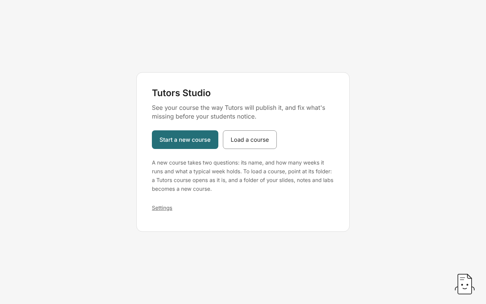
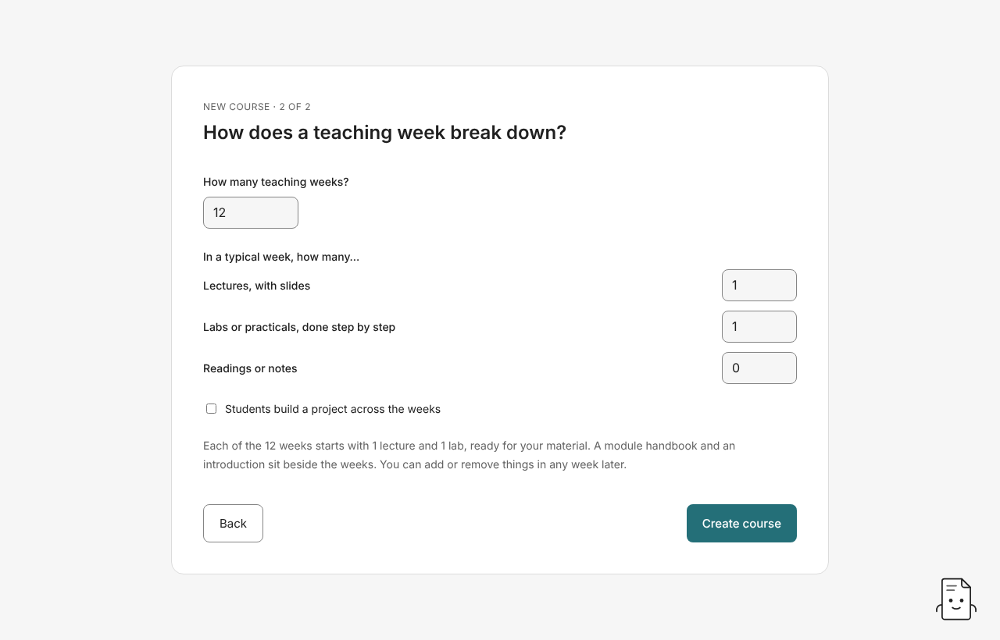

# 1. Getting started

## Install Studio

Download the installer for your computer and open it. You don't need administrator rights. Step-by-step help, including what to click when your computer asks whether to open Studio, is in [Installing Tutors Studio](../install.md).

## The start screen

When Studio opens you can:

- **Start a new course**: answer two questions and Studio makes the course folder for you.
- **Load a course**: point at a folder. If it's already a Tutors course, Studio opens it as it is. If it's a folder of your own slides, notes and labs, Studio makes a new course from it.
- **Your courses**: the courses you opened lately, newest first, up to eight. Click one to open it.

Studio reopens the course you had open last. If that course's folder has been moved or deleted, Studio takes it off the list and tells you.

### Taking a course off the list

Press **Forget** beside a course to take it off **Your courses**. Its folder and files stay exactly where they are. Changed your mind? **Put it back** returns it to the same place in the list. To open a forgotten course again, use **Load a course** and choose its folder.

## Start a new course

1. **What is the course called, and who teaches it?** Type the course name. The lecturer's name is optional. Students see it.
2. **How does a teaching week break down?** Say how many teaching weeks the course runs, then how many lectures, labs and readings a typical week holds. Tick **Students build a project across the weeks** if they do, and Studio adds a project specification and starter code beside the weeks.
3. Press **Create course** and choose where to put the course folder. Studio makes a new folder there, named after the course.

Every week starts with the lectures, labs and readings you asked for, ready for your material. A module handbook and an introduction sit beside the weeks. You can add or remove anything later.

Studio won't make the course if:

- an answer is missing or out of range. It names each answer to change.
- a week would hold nothing, or more than five of one kind. It says what to change.
- a folder with the course's name is already there. Studio leaves that folder alone and says nothing was created.

A new course always passes Tutors' checks. There's no start date question. If you want a calendar, set **Teaching starts** later under Course details (see [Arranging a course](06-arranging.md#course-details)).

## Load a course you already have

Press **Load a course** and choose a folder.

- **A Tutors course** (it has a `course.md`) opens as it is. Studio writes nothing when it opens a course.
- **A folder of your own material** (slides, notes, lab sheets) becomes a new course. Studio asks for the course name, the lecturer (optional) and when teaching starts (optional, for the calendar). It then makes a week for each week number it finds in your file and folder names (`Week 3`, `wk03`, `03-...`) and puts each file it recognises into that week, each as its own lecture, reading, lab or link. You choose where the new course goes. **The folder you loaded is never changed.** Files it couldn't place stay in your folder so you can drop them on a week once the course is made.

If the folder holds nothing Studio can place in a week, it says what it looks for and makes nothing.

## Next

[Finding your way around a course](02-course-map.md)
