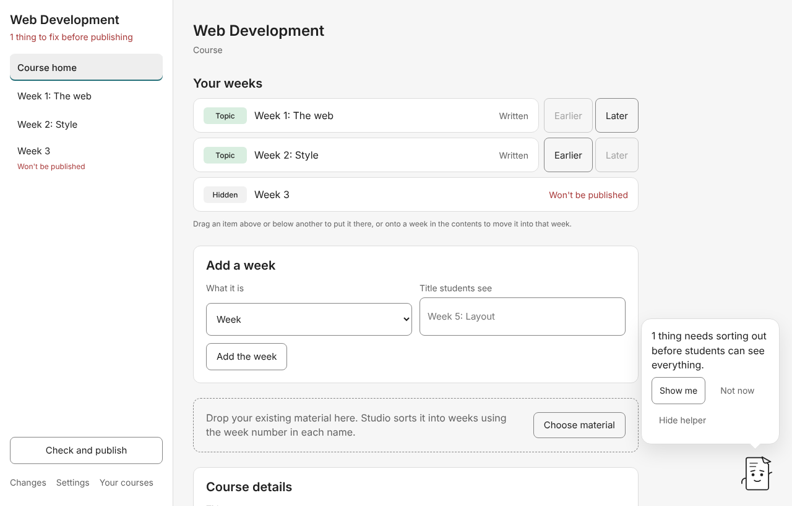
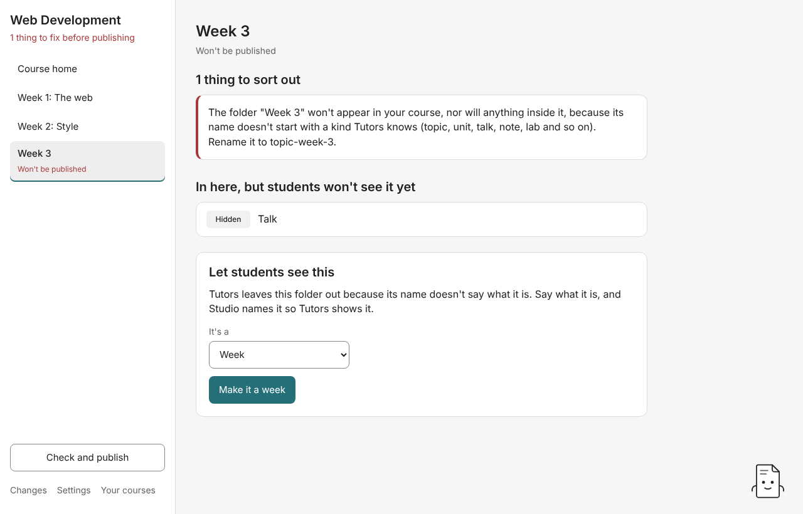
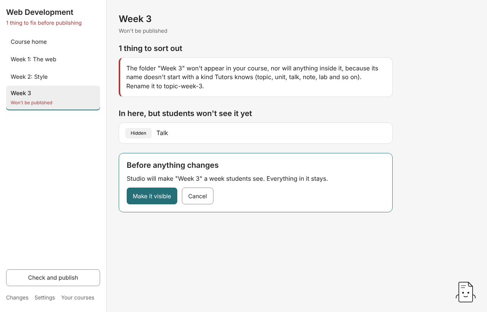
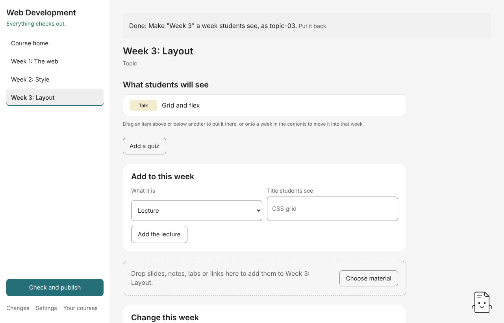

# 2. Finding your way around a course

## The course home

The left-hand side is the **contents**: **Course home**, then every week by the title students see. Under the course name, Studio says whether anything needs fixing before you publish (for example "1 thing to fix before publishing"), or "Everything checks out."

At the bottom of the contents:

- **Check and publish**: every problem in one list, and the ways to put the course online ([guide 8](08-check-and-publish.md)).
- **Changes**: what Studio changed since you opened this course, and **Put back** for each ([guide 7](07-undo-and-changes.md)).
- **Settings** ([guide 10](10-settings.md)).
- **Your courses**: back to the start screen.

The course home shows **Your weeks**, **Add a week**, a drop area for a whole folder of material, **Course details**, the course's card picture, and the course's own page with **Write**.

## What the labels mean

Each item has a tag saying what Tutors will show it as, such as **Topic** (a week), **Talk** (a lecture), **Lab**, **Note** (a reading), **Web link**, **Video**, **Archive** (a download) or **Quiz**. An item tagged **Hidden** is in the course folder, but Tutors won't publish it.

Each week also shows one state, the first that applies:

| Label                           | Meaning                                                                         |
| ------------------------------- | ------------------------------------------------------------------------------- |
| **Won't be published**          | Tutors will leave this week out, along with everything inside it. Fix it first. |
| **Needs sorting out**           | Something in this week has a problem Tutors' rules flag.                        |
| **Empty so far**                | The week has nothing in it yet.                                                 |
| **Still to write**              | At least one page still holds the starter text Studio wrote.                    |
| **Changed since you published** | You've changed something in this week since you last published from Studio.     |
| **Written**                     | Every page has been written and nothing needs fixing.                           |

Studio keeps watching the course folder. If you change files in another app, such as saving slides from PowerPoint into the folder, the course map updates by itself.

## Opening a week or an item

Click a week in the contents to open it. A week's page shows **What students will see** in the order they'll see it. Under that you'll find **Add a quiz**, **Add to this week**, a drop area for files, **Change this week**, the card picture and the week's own page.

Click any item (a lab, a lecture) to open it. **Back to …** returns you to its week.

## Fixing "Won't be published"

Tutors decides what something is from its folder name. A folder called `Week 3` doesn't say what it is, so Tutors leaves it out, along with everything inside it. Studio shows the explanation Tutors' rules give. It's the same sentence `tutors validate` prints.

Under **Let students see this**, choose what it is (**It's a** Week, Section, Lecture, Lab, Reading…) and press the button, such as **Make it a week**. Studio shows the plan:

Press **Make it visible**. Studio renames the folder to what Tutors reads (`topic-03`, say), keeps everything inside it, and adds only the files that kind still needs. For a folder of pages turned into a lab, Studio also numbers the pages as steps, in name order.

Studio never guesses the kind for you. A folder whose name doesn't say what it is waits for you to choose, and **Fix all safe** leaves it alone too.

Something inside a week that won't be published is hidden too. Studio says so on the item: sort out the week first.

## Next

[Adding material](03-adding-material.md)
