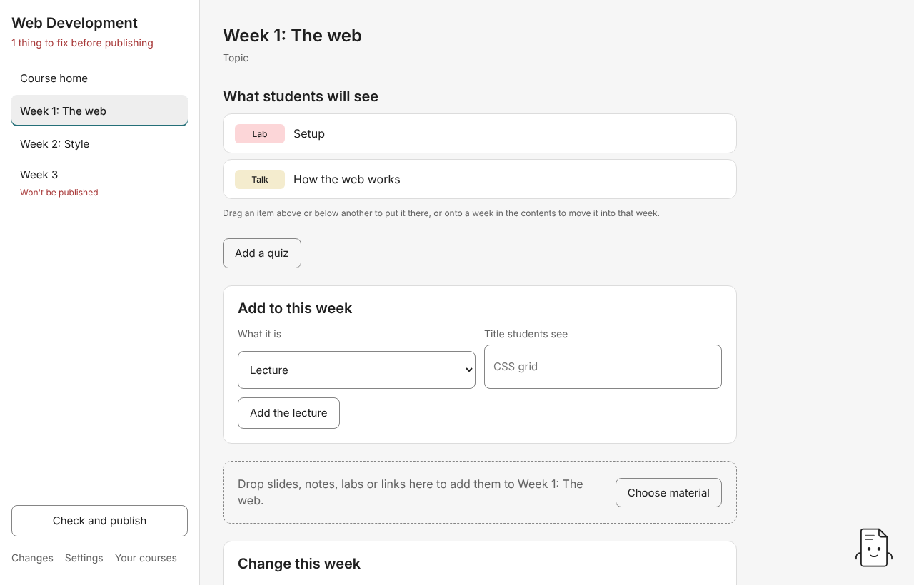

# 3. Adding material

There are four ways to add to a course. Use whichever suits what you have.

## Add by name

On a week's page, **Add to this week** has a **What it is** list in your own words, and a **Title students see**:

| Choose                         | Students see                                              | Also asks for       |
| ------------------------------ | --------------------------------------------------------- | ------------------- |
| **Lecture**                    | A lecture card (a Talk)                                   |                     |
| **Lecture, written as slides** | A lecture whose page starts as a slide deck to write over |                     |
| **Lab**                        | A lab, done step by step                                  |                     |
| **Reading**                    | A page of notes (a Note)                                  |                     |
| **Link**                       | A card that opens a web page                              | The web address     |
| **Code repository**            | A card that opens a GitHub repository                     | The repository      |
| **Video link**                 | A video card                                              | The video's address |

On the course home, **Add a week** adds a **Week** (numbered after the last) or a **Section** at the top of the course, which groups weeks.

Press **Add the lecture** (or lab, reading…). Studio shows the plan: the folder it will make and the first files it needs. Nothing is made until you accept. If a title or address can't make an item, Studio says what to change.

New items start with a line of starter text. Their pages show **Still to write** until you write them ([guide 5](05-writing-pages.md)).

## Drop files on a week

Drag files from your computer onto a week in the contents, or anywhere on a week's page. You can also press **Choose material**. Each file becomes its own item, of the kind Tutors shows it as:

| You drop                                                                    | Studio makes                                           |
| --------------------------------------------------------------------------- | ------------------------------------------------------ |
| A PDF                                                                       | A lecture (Talk) showing the PDF                       |
| A Markdown file                                                             | A reading (Note)                                       |
| A Word or PowerPoint file                                                   | A reading (Note) linking the file, zipped, to download |
| A zip                                                                       | A download (Archive)                                   |
| A link file (`.url`, `.webloc`, or a `.txt` whose first line is an address) | A link card                                            |
| A folder of two or more numbered pages (`01 Setup.md`, `02 Build.md`)       | A lab, one step per page                               |

**A drop on a week goes straight in.** Studio adds each file it can place without asking first, then shows **Done:** with **Put it back**, which undoes the whole drop in one go. (This is the one place Studio doesn't ask first. Dropping on a week is already a clear choice.)

A file of a kind Tutors doesn't show, such as an Excel sheet or a Keynote file, is still kept. Studio copies it, unopened, into the week's working-files folder (`files/`). The course map then flags it in the rules' own words, so you know students won't see it.

A file that would sit loose beside a lab's steps goes into the lab's attachments instead, and extensions are written in lower case so Tutors publishes them. [Where your files go](04-where-files-go.md) explains why, and when to attach a file to a page instead of dropping it.

## Drop a whole folder on the course

On the course home, drop a folder of material on the dashed area (or press **Choose material**). Studio reads the week number in each file or folder name (`Week 3 slides.pdf`, `wk03/`) and proposes putting each item in that week. This drop shows the plan first, because it touches many weeks.

### The tray

Files Studio can't place are **Left in the tray**, each with the reason:

- nothing in its name says which week it's for, or
- its name gives a week the course doesn't have yet.

Choose a week for a tray file (**Choose a week**) and Studio proposes placing it there.

## My files

**My files** keeps your own folder of slides, notes and labs beside the course. Press **Choose your folder…** and Studio lists what's in it, folders first. Drag any file or folder onto a week and Studio proposes the same plan as dropping it there, **copying** it into the course. Studio never writes to your folder. **Another folder** switches to a different one.

## Quizzes

On a week's page, **Add a quiz** opens the quiz designer. See [Writing pages](05-writing-pages.md#quizzes).

## Next

[Where your files go](04-where-files-go.md)
