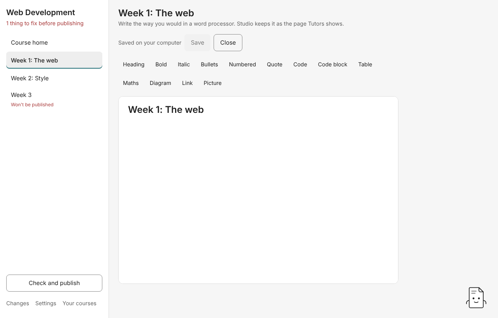
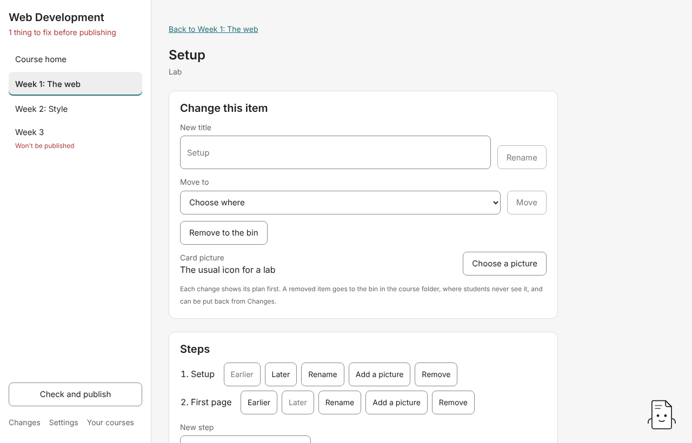
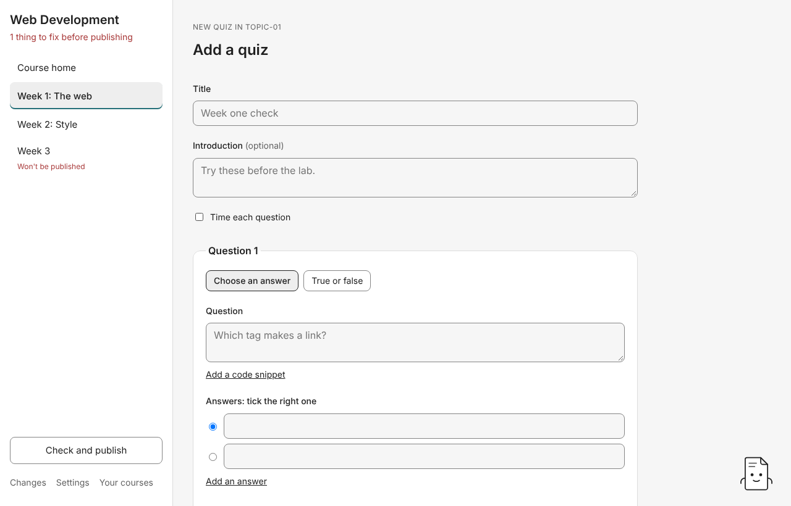

# 5. Writing pages

## Write a page

Every week, lecture, lab step and reading has a page. Under **…'s pages**, each page shows **Not written yet** while it still holds the starter text Studio made it with, or **Written** once you've saved your own words. Press **Write** to open it.

Write the way you would in a word processor. The bar has **Heading**, **Bold**, **Italic**, **Bullets**, **Numbered**, **Quote**, **Code**, **Code block**, **Table**, **Maths**, **Diagram**, **Link** and **Picture**, and **Attach a file** on readings and lab steps.

- **Attach a file** (readings and lab steps only) saves a file with the page and puts a download link where your cursor is. You can also drop a file into the page. See [Where your files go](04-where-files-go.md#attach-a-file).
- **Table, Maths, Diagram and Code block** add what Tutors reads (a markdown table, a LaTeX formula, a Mermaid diagram, a fenced code block). Studio keeps them as text and doesn't draw them. The published course draws them.
- Settings at the top of a page between `---` lines are kept exactly as they were, and you write the rest.
- If a page holds something plain writing can't keep, Studio says what it is and leaves that page to the markdown editor (Advanced mode).

Press **Save**. Studio shows the plan: "Studio will save your changes to this page. Nothing else is touched." Press **Save the page** to write it, or **Keep writing**. What you save reads back exactly as you wrote it.

## The markdown editor (Advanced mode)

With **Advanced mode** on ([Settings](10-settings.md)), **Edit the markdown** opens a page's markdown beside a preview. The preview never runs raw HTML from a page. **Save** offers a plan that writes only that page. If the page changed on disk after you opened it (in another editor, say), Studio offers no plan and tells you, so nothing is overwritten.

## Lectures written as slides

Add a **Lecture, written as slides** ([Adding material](03-adding-material.md)) and its page starts as a Marp slide deck. The first slide is the lecture's title. The next slides, split by `---` lines, are there to write over. Tutors shows the deck as slides. Studio shows the text.

## Lab steps

Open a lab to see its **Steps** in order. For each step:

- **Earlier** / **Later** renumber the steps in their new order. Every page is kept as it is.
- **Rename** renames the step's page and its heading.
- **Add a picture** copies a picture into the lab's pictures under a plain name and shows it at the end of the step.
- **Remove** moves the step to the bin and renumbers the steps after it.

Type a title under **New step** and press **Add the step** to add the next numbered step at the end. Each of these shows its plan first.

**Draft steps from my notes** asks your assistant to turn notes you paste into steps ([guide 9](09-assistant.md#drafts-and-suggestions)).

## Quizzes

On a week's page, **Add a quiz** opens the designer. Give it a **Title**, an optional **Introduction**, and optionally **Time each question** (seconds per question). For each question, choose **Choose an answer** or **True or false**, type the question, optionally **Add a code snippet** with its language, then add answers and tick the right one. **Add a question** adds another. **Move up** and **Move down** reorder them.

**Save quiz** shows the plan, and Studio writes one new quiz into the week. Students see the questions and the answers you ticked. If a question can't be saved so the reader shows it as typed (no right answer ticked, say), Studio changes nothing and names that question in the rules' words.

To change a quiz, open it and press **Edit this quiz**. Studio shows its title, time limit, questions and answers with no markdown. Saving rewrites only that quiz's page and keeps its title and introduction. If the page holds a question the reader already leaves out, Studio names it when the quiz opens, before saving would drop it.

## Next

[Arranging a course](06-arranging.md)
