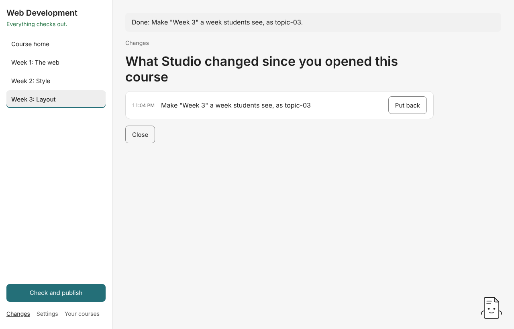

# 7. Undo and Changes

**Changes**, at the foot of the contents, lists every change Studio made to the open course since you opened it, newest first, with the time each was made.

## Put a change back

Press **Put back** beside a change. Studio shows the plan that reverses it and applies it only once you accept. Straight after a change, the **Done:** line at the top of the screen also has **Put it back**, which opens the same plan.

- A change that **added** files is put back by moving those files to the course's bin. Nothing is deleted.
- A change that **moved or renamed** something is put back by moving it back.
- If a file the change wrote has **changed since** (you edited it in another app, say), Studio leaves that change in place and names the file, so your later work isn't lost.

The list starts fresh each time you open the course. For history further back, use the course's own Git history (Advanced mode, [guide 8](08-check-and-publish.md#hand-off-to-github-advanced-mode)) or your computer's backups.

## Why Studio is safe to try

- Studio changes a course only by applying a plan you've accepted. The one exception is dropping files on a week, which goes straight in and offers **Put it back** for the whole drop.
- A plan is applied whole or not at all. If something blocks it part-way (a file open in another app on Windows, say), Studio undoes every change that plan made and names the file that blocked it.
- Studio refuses any plan that would touch a file outside the course folder before it changes anything.
- The helper and any assistant never write to a course. They can only suggest a plan for you to accept.

## Next

[Check and publish](08-check-and-publish.md)
