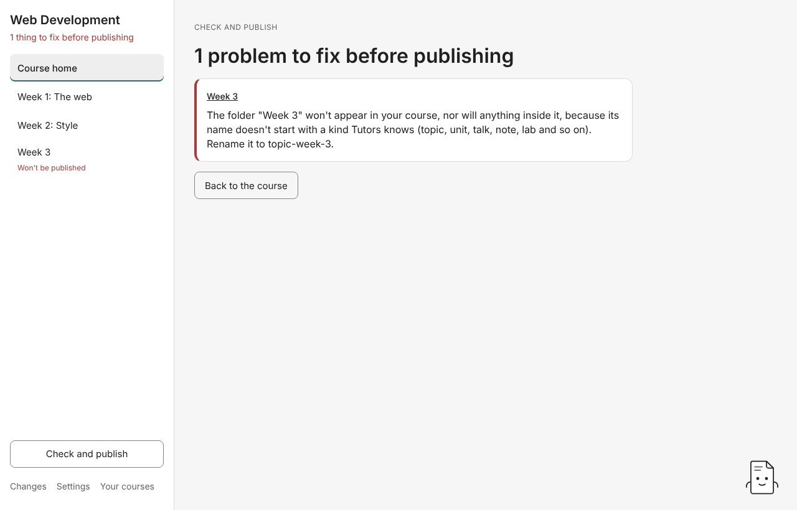

# 8. Check and publish

## Check

**Check and publish**, at the foot of the contents, lists every problem Tutors' rules find in the course, errors first, each in the rules' own words. Click where a problem is (the week or item name) to go straight to it.

The heading says either **Ready to publish** or how many problems to fix first. Errors stop the course from being saved or published. Warnings are worth a look but don't block anything.

### Fix all safe

When some fixes are safe (renames that change nothing else, and the standard setup Tutors expects), **Fix all safe (N)** gathers them into one plan, with the deepest files renamed first. Studio says how many items it will rename and how many setup files it will add, and **See exactly what changes** lists each one. Press **Make these changes** to apply them all at once. They come back with one **Put back**.

Some things are never in **Fix all safe**, for example a folder whose name doesn't say what it is. Only you can say whether it's a week, a lecture or a lab ([guide 2](02-course-map.md#fixing-wont-be-published)).

With Advanced mode off, Studio doesn't list a missing setup file (like `netlify.toml`) as a problem. It adds it for you when you save or publish.

## Publish

The **Publish** screen, **Put your course online for your students**, has up to three choices. Open it from the helper's **Publish** button, which appears once the course checks out. It works in the desktop app only.

### Publish online (Netlify)

1. **Sign in once.** The first time, **Sign in under Settings** takes you to **Settings → Accounts**. Press **Sign in to Netlify**: Netlify's own page opens in your browser, you press **Authorize** there, and Studio keeps what Netlify returns in your computer's keychain. (A copy of Studio built without Netlify's sign-in instead asks for a **Code from Netlify**, a personal access token made in Netlify under User settings, Applications, Personal access tokens.)
2. **Choose your course's address**: lower-case letters, digits and single hyphens, such as `web-dev-2026`. Students will read it at `tutors.dev/course/web-dev-2026`.
3. Press **Publish for students**. In that one press, Studio saves the course with any setup it lacks, checks it, builds it with the Tutors generator and sends Netlify only the files it doesn't already hold.

Studio remembers the address for each course. Next time the screen says **Your course is online**, when it was last published, and what was **added, changed and removed since**, by title. Publishing again is one press of **Publish changes**, with the students' link beside it. On the course home, weeks you've changed since then show **Changed since you published**.

Studio refuses to publish a course with errors and says how many to fix. If Netlify refuses the sign-in, Studio publishes nothing and says how to sign in again.

**Building needs Deno** (free, from deno.com) or, if Deno isn't installed, Docker or Podman, which Studio uses to run Deno's own pinned image. Saving the course needs neither.

### Just save it on this computer

**Save the course** checks the course and adds any setup Tutors expects that's missing (the `netlify.toml` and the `.gitignore` line), in the course's own folder. Nothing goes online. Use it when someone else publishes the course, or when it publishes from GitHub. If the course has errors, Studio changes nothing and says how many to fix.

### See it in Tutors on this computer

**See it in Tutors on this computer** shows the course in Tutors itself, run from your own copy of Tutors, while you write it. Every change you make shows there a moment later. Nothing leaves your computer, and students see nothing until you publish.

You need a copy of Tutors first, once:

1. Install [Node](https://nodejs.org) and [pnpm](https://pnpm.io/installation).
2. Clone [tutors-sdk/tutors-mono-repo](https://github.com/tutors-sdk/tutors-mono-repo) somewhere on your computer, open a terminal in that folder and run `pnpm install`.

Then, on the **Publish** screen:

1. Press **Choose your copy of Tutors…** and choose the folder you cloned. Studio remembers it. If the folder isn't a copy of Tutors, or `pnpm install` hasn't been run in it, Studio says so and remembers nothing.
2. Press **Show it in Tutors**. Studio builds the course, serves it on this computer, starts Tutors from your copy (the first time takes a minute or two) and opens the course in a **Tutors on this computer** window beside Studio. If Tutors is already running (you ran `pnpm dev` yourself), Studio uses it.
3. Carry on writing. After each change, Studio rebuilds the course and the Tutors window reloads on the page it was showing. **Live in Tutors** at the foot of the contents says it's running, with **Open** (in your browser, where you reload the page yourself) and **Stop**.

If a change doesn't build, the Tutors window keeps the last build and Studio says why. **Stop**, going back to **Your courses**, or quitting Studio stops serving the course, and stops Tutors if Studio started it.

What you see is the Tutors you cloned, so it can be newer than tutors.dev. Building needs Deno, or Docker or Podman, as for publishing.

### As a website on this computer (Advanced mode)

**Save as a website…** builds the course with tutors-lite into a folder of web pages that opens in any browser without the internet, and saves it as `<course>-website` in a folder you choose. It never saves over a folder that's already there. Open `index.html`, or copy the folder to any web host. It too refuses a course with errors.

### The last check

When your copy of Studio carries a Tutors command line that can validate, saving and publishing run `tutors validate` as the very last check. If it finds an error the course map missed, Studio changes nothing, puts nothing online and shows the command line's own words.

## Hand off to GitHub (Advanced mode)

If the course folder is a Git repository, **Check and publish** in Advanced mode also shows **Hand off to GitHub**: the branch, where it pushes to, and how many files have changed since the last commit (**Changed files** lists them). Type a message, such as `Week 3 slides`, and press **Commit and push**. Studio adds every change, commits it with your message, and pushes the branch with your computer's own Git and its existing sign-in. Netlify (or whatever builds from GitHub) takes it from there.

Studio commits nothing when:

- the course has errors. It says how many to fix.
- the course's `.gitignore` doesn't leave out the generated `json/` folder. Press **Leave json/ out of git** for the plan that adds it.
- the folder isn't a Git repository. Studio says so and points you to Publish. GitHub Desktop can make the folder a repository in one step.

Studio only ever runs `git status`, `add`, `commit` and `push`. It never pulls, merges, rebases or force-pushes.

## Next

[The helper and assistants](09-assistant.md)
