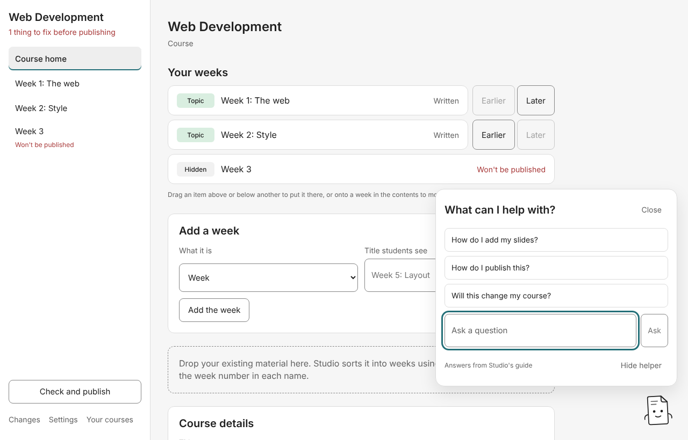

# 9. The helper and assistants

## The helper

The paper note in the bottom corner is the helper. It speaks up at a few moments, for example when a course with problems opens ("1 thing needs sorting out…" with **Show me**), when a new course is ready, when everything checks out (with **Publish**), and when you open an empty week. It never speaks while you're typing or dragging, and it won't repeat itself within ten minutes. **Not now** dismisses a moment.

Click the note to ask it something: pick a suggested question or type your own under **Ask a question**. With no assistant chosen, it answers from Studio's own guide ("Answers from Studio's guide").

**Hide helper** puts it away until you bring it back under **Settings → Helper → Show the helper**. Studio remembers your choice. The helper never writes to a course.

## Choosing an assistant

An assistant explains a course's problems in plainer words and answers your questions about the screen you're on. **Studio works fully without one.** Choose under **Settings → Assistant**:

| Choice                       | What it means                                                                                                                                                                                                                                                                                                                                                                                                                |
| ---------------------------- | ---------------------------------------------------------------------------------------------------------------------------------------------------------------------------------------------------------------------------------------------------------------------------------------------------------------------------------------------------------------------------------------------------------------------------- |
| **None**                     | Explanations are the rules' own sentences; the helper answers from Studio's guide.                                                                                                                                                                                                                                                                                                                                           |
| **A model on this computer** | Runs a model through [Ollama](https://ollama.com/download), free. Nothing you ask leaves the computer, so it needs no permission per course. Answers are slower. Studio lists the models Ollama already has, smallest first, and uses the smallest until you pick another. If Ollama has none, Studio offers to download a small one. If Ollama isn't running, Studio says how to start it, and **Check again** looks again. |
| **Claude**                   | Paste a **Claude API key** from the Claude Console. Studio keeps it in the computer's keychain, never in its settings. Each answer costs a little on that account. If Claude refuses the key, Studio says how to make a new one.                                                                                                                                                                                             |

### What Claude may read

Because Claude runs on Anthropic's computers, Studio sends it **nothing from a course until you allow it, course by course**. On **Check and publish**, tick **Let Claude read this course's problems…**. When you ask, Studio then sends your question, the screen you're on and the checker's sentences, including any names they mention. It never sends your pages. Leave it off for a course whose names you can't share.

If an assistant can't answer (no network, say), the helper answers from Studio's guide and says why.

## Drafts and suggestions

An assistant can also propose changes. It answers in text, and Studio turns that into a plan you accept, exactly like any other change.

- **Draft steps from my notes** (on a lab): paste what students build, the tools they need and the order. Studio sends only those notes and proposes adding the drafted steps after the lab's own.
- **Ask Claude to suggest titles and an order** (on a week, named after your assistant): Studio sends only the week's titles and the start of each page, and proposes one plan that retitles and reorders the week as suggested.

If no assistant is chosen, or its answer can't be read as steps or a list, Studio says so and proposes nothing.

## Next

[Settings](10-settings.md)
