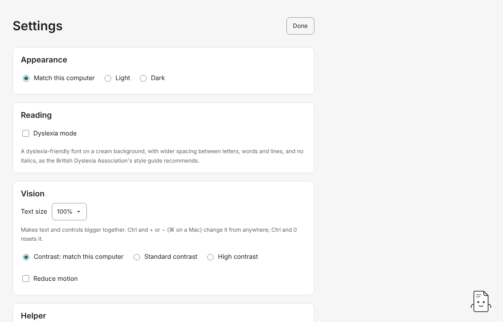

# 10. Settings

Open **Settings** from the start screen or the foot of the contents. Changes take effect straight away and Studio remembers them. **Done** closes Settings.

## Appearance

**Match this computer**, **Light** or **Dark**. Every screen follows it, including the helper and the editors.

## Reading

**Dyslexia mode** shows text in a dyslexia-friendly font on a cream background, with wider spacing between letters, words and lines and no italics, as the British Dyslexia Association's style guide recommends. Choose **OpenDyslexic** or **A plain font (Verdana)**.

## Vision

- **Text size**, from 100% to 200%, makes text and controls bigger together. Ctrl and + or − (⌘ on a Mac) change it from anywhere, and Ctrl and 0 resets it.
- **Contrast**: **Match this computer**, **Standard contrast** or **High contrast**. High contrast is black on white (or white on black) with solid borders and a thicker focus ring.
- **Reduce motion** stops animation, including the helper's.

Studio aims for WCAG 2.1 AA in both light and dark, and every screen works by keyboard and screen reader.

## Helper

**Show the helper** brings back the paper note after you've hidden it ([guide 9](09-assistant.md)).

## Assistant

**None**, **A model on this computer** or **Claude**. See [The helper and assistants](09-assistant.md#choosing-an-assistant).

## Accounts

**Sign in to Netlify** once to publish ([guide 8](08-check-and-publish.md#publish-online-netlify)). **Sign out of Netlify** forgets the sign-in. Studio keeps the sign-in in the computer's keychain.

## Advanced

**Advanced mode** is for people comfortable with files and markdown. It adds:

- file and folder names on every screen, and "Course folder" in place of "The whole course";
- **Edit the markdown** on every page ([guide 5](05-writing-pages.md#the-markdown-editor-advanced-mode));
- the rules version, and the technical words for findings and plans (each rename listed in full);
- **Hand off to GitHub** and **Save as a website…** under Check and publish ([guide 8](08-check-and-publish.md)).

Everything else works the same. Studio remembers the switch.

## Usage counts

**Count how often I use Studio's main actions** is off until you turn it on. While it's on, Studio counts each publish, save, accepted change, Git hand-off and assistant draft or suggestion, as a number by name. The counts never leave your computer. **Copy the counts** gives Studio's version and the numbers only, with no file names, course names or anything you wrote, so you can paste them to whoever asked. Turning counting off clears the counts.

## Updates

Shows which version of Studio this is. **Check for a newer version** downloads nothing. If a newer Studio is out, it names the version, and **Install … and restart** installs it only when you press it. A copy of Studio without an update key (a build you made yourself, say) offers **Open the download page** instead.

## Next

[Studio from a terminal](11-command-line.md)
