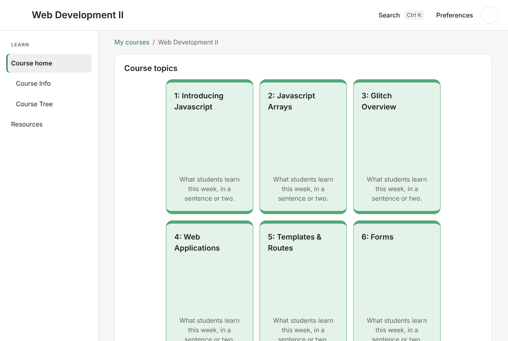

# Build Web Development II in Studio

This walks through making [edeleastar/module-web-dev-2-2022](https://github.com/edeleastar/module-web-dev-2-2022) in Studio, from nothing to a course students can open. It uses the words you see on screen. The other guides explain each screen in more depth.

You'll need:

- Studio, installed ([docs/install.md](../install.md)).
- A copy of Tutors on your computer, to watch the course take shape as you build it: [Node](https://nodejs.org), [pnpm](https://pnpm.io/installation), and [tutors-sdk/tutors-mono-repo](https://github.com/tutors-sdk/tutors-mono-repo) cloned with `pnpm install` run in it once. Optional, but it's how this guide shows each step.
- The module's own material: its slide PDFs, its lab steps and its pictures. If you have a copy of the repository, every lecture's PDF is in that lecture's folder (for example `topic-01-js-intro/unit-1/talk-1-overview/review.pdf`) and every lab's steps are the numbered `.md` files in its `book-…` folder.

Studio never copies that material for you. The reference course gives you the shape: every week, section, lecture, lab and lab step, with their titles. You bring the content.

## 1. Make the course

1. On the start screen, press **Start a new course**.
2. Type **Web Development II** as the course name, and your name as the lecturer if you want students to see it. Press **Continue**.
3. Under **Start from a reference course, a template, or your own week?**, keep **A reference course** and choose **Web Development II** in the **Reference course** list. Studio says: 8 weeks, 51 items, shaped on edeleastar/module-web-dev-2-2022.
4. Press **Create course**, choose where the course folder goes, and accept the plan.

The course opens with all eight weeks, each marked as still to write:

| Week                      | Sections inside it                                                 | What it holds                                                    |
| ------------------------- | ------------------------------------------------------------------ | ---------------------------------------------------------------- |
| 1: Introducing Javascript | Introducing Javascript                                             | Lab 01 JS Intro, 4 lectures                                      |
| 2: Javascript Arrays      | Javascript Variables, Objects & Methods; Javascript Arrays         | Lab 02 JS Arrays, 6 lectures                                     |
| 3: Glitch Overview        | Introducing Glitch; Glitch Deep Dive                               | Labs 03a to 03d, 3 lectures                                      |
| 4: Web Applications       | Playlist 1                                                         | Labs 04a and 04b, 4 lectures                                     |
| 5: Templates & Routes     | Views, templating + JSON Models; Controller, Routes & Models       | Lab 05 Playlist 2, 5 lectures                                    |
| 6: Forms                  | Forms                                                              | Lab 06 Playlist 3, 3 lectures                                    |
| 7: Sessions               | Reintroducing Sessions; Implementing Sessions                      | Labs 07a to 07c, 4 lectures                                      |
| 8: Weather Top V2         | WeatherTop V1 Solution; WeatherTop V2 Specification; APIs & Charts | Labs 08a to 08c, 3 lectures, 2 links, the project submission zip |

Press **Check and publish** now if you like: the new course already passes Tutors' checks.

## 2. Watch it in Tutors on this computer

Keep the course open in Tutors itself while you work, so you see each change as a student will.

1. Press **Check and publish**, then open the **Publish** screen.
2. Under **See it in Tutors on this computer**, press **Choose your copy of Tutors…** and choose the folder you cloned tutors-mono-repo into. Studio remembers it.
3. Press **Show it in Tutors**. Studio builds the course, serves it on your computer, starts Tutors from your copy (the first time takes a minute or two), and opens a **Tutors on this computer** window at the course home: eight week cards, each saying what students learn this week in starter text.
4. Go back to the course. **Live in Tutors** at the foot of the contents shows it's running.

Working from a terminal instead? `pnpm headless <course folder> live <your copy of Tutors>` does the same and prints the link. Reload the page in your browser after each change ([Studio from a terminal](11-command-line.md#the-course-live-in-tutors-on-this-computer)).

From now on, every change you make in Studio rebuilds the course, and the Tutors window reloads on the page it was showing. Leave it beside Studio as you work through the steps below. If a change doesn't build, the window keeps the last build and Studio says why. Nothing here reaches students: they see the course only when you publish it in step 7.

## 3. Write the course and week pages

1. On the course home, open **Course details** and check the title and credits ([Arranging a course](06-arranging.md#course-details)).
2. Open each week. Under the week's pages, press **Write** on the week's own page, write a line or two on what the week covers, and press **Save** then **Save the page**. The week's card in the Tutors window shows your words a moment later.

## 4. Add each lecture's slides

Each lecture comes as a card with a page of starter text. To give it the original slides:

1. Open the week and drop the lecture's PDF on it (for week 1, `review.pdf`, `js-background.pdf`, `js-variables.pdf` and `js-variables-objects.pdf`). Each PDF becomes its own lecture card straight away, with **Put it back** if you change your mind.
2. A dropped card takes the file's name. Use **Change this item** → **Rename** to give it the title from the table above (for example `review` becomes **Module Overview**).
3. Drag the new card into its section, just above or below the starter lecture it replaces.
4. Use **Change this item** → **Remove to the bin** on the starter lecture.

Open the week in the Tutors window to check each lecture opens its slides.

Drop the Keynote files (`.key`) too if you want Studio to keep them: Tutors never shows them to students ([Where your files go](04-where-files-go.md)).

If you'd rather write a lecture as slides in Studio, leave the starter card and press **Write** on it instead ([Writing pages](05-writing-pages.md#lectures-written-as-slides)).

## 5. Write each lab's steps

Every lab already has its steps, titled as the original lab titles them. Lab 01 JS Intro, for example, opens with its first page and then its steps.

1. Open the lab. Its **Steps** are listed in order.
2. Press **Write** on each step and paste or type that step's text from the original (`01.01.md`, `02.02.md`, … in `book-b-js-introduction`).
3. For a picture a step shows, use **Add a picture** on the step, or **Picture** while writing.
4. For a download a step links to (the `archives` zips in labs 02 and 03a), use **Attach a file** while writing that step.

A step's page shows **Written** once you've saved your own words, so the lab's progress is visible at a glance. Open the lab in the Tutors window and page through it as a student would: each step you save appears there after the rebuild.

## 6. Add what the template leaves out

The reference course copies no videos and no GitHub cards, because each needs an address only you have.

- **Videos.** Each week of the original has a video beside it, and most lectures have one too. On the week's page, use **Add to this week** → **Video link** with the video's address.
- **Week 8 links.** **WeatherTop Repo** and **Assignment Submission** already keep the original addresses. If your module has its own repository or submission page, remove the card to the bin and add yours with **Add to this week** → **Link**.
- **Project Submission Template.** Drop your own submission template zip on week 8 and remove the starter one to the bin.
- **Card pictures.** The original weeks have their own pictures (`topic.png`). Add them under **Card pictures** ([Arranging a course](06-arranging.md#card-pictures)).

## 7. Check and publish

1. Look through the course in the Tutors window one last time: every week, lecture and lab as students will see it.
2. Press **Check and publish**. Fix anything it lists. **Fix all safe** handles renames and setup in one go ([Check and publish](08-check-and-publish.md)).
3. When it says **Ready to publish**, choose **Publish online** or **Save the course**. Publishing online puts it on tutors.dev for students. The Tutors window stays on your computer only.
4. Press **Stop** beside **Live in Tutors** when you're done for the day. Next time, **Show it in Tutors** picks up where you left off.
5. Weeks you haven't finished can wait: use **Change this week** → **Hide from students** until they're ready.

## What changed from the original

- Folder names follow Studio's pattern (`topic-01-introducing-javascript`, `lab-01-js-intro`, `talk-02-js-introduction`), not the original's (`topic-01-js-intro`, `book-b-js-introduction`). Tutors reads both the same way, and students only see titles.
- Labs are built from the original `book-…` folders. Each lab's first page and steps keep their titles, and each step's page is named after its title (`01.Running-Javascript.md` rather than `01.01.md`).
- Nothing from the original pages, slides or PDFs is in the new course until you add it.
